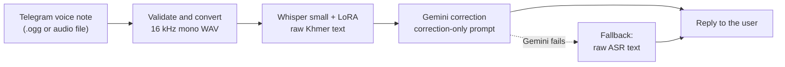
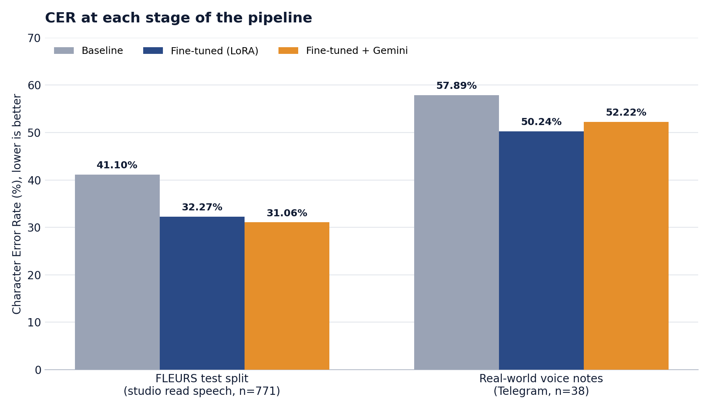

<p align="center">
  
</p>

<p align="center">
  
  
  
  
  
  
</p>

<p align="center">
  <a href="#overview">Overview</a> &nbsp;|&nbsp;
  <a href="#how-it-works">How it works</a> &nbsp;|&nbsp;
  <a href="#results">Results</a> &nbsp;|&nbsp;
  <a href="#quick-start">Quick start</a> &nbsp;|&nbsp;
  <a href="#data">Data</a> &nbsp;|&nbsp;
  <a href="#known-limitations">Limitations</a>
</p>

---

## Overview

Khmer is a low-resource language: public speech data is scarce, and most of it is clean, studio-style read speech. A Telegram voice note is the opposite: casual, noisy, and heavily compressed.

This project closes part of that gap. It starts from an existing Khmer Whisper checkpoint ([`seanghay/whisper-small-khmer-v2`](https://huggingface.co/seanghay/whisper-small-khmer-v2)), fine-tunes it further with LoRA on more data (including phone-microphone augmentation), and passes the raw transcript through a Gemini correction step before the bot replies.

It was built as a Year 4 thesis at the Institute of Technology of Cambodia (ITC) and as an internship project at the National Institute of Science, Technology and Innovation (NISTI).

**Highlights**

- **Lower error on both test sets.** Character Error Rate (CER) fell from 41.10% to 32.27% on FLEURS (21.5% relative) and from 57.89% to 50.24% on real Telegram voice notes (13.2% relative).
- **Cheap to train.** LoRA trains 1.77M of 243.5M parameters (0.73%), which fits on a free Colab T4 GPU.
- **Tested on the real use case.** Besides the FLEURS benchmark, the model is scored on 38 spontaneous Telegram voice notes that were never used for training.
- **Fails gracefully.** If the Gemini call fails, the bot sends the raw transcript instead of an error.
- **Honest about limits.** LLM correction helped on FLEURS but slightly hurt on real voice notes. Both results are reported in full below.

## How it works



| Stage      | Module                  | What it does                                                                                                                             |
| ---------- | ----------------------- | ---------------------------------------------------------------------------------------------------------------------------------------- |
| Validate   | `src/audio/validate.py` | Rejects unsupported file types, empty files, and files over Telegram's 20 MB download limit, with a clear message to the user            |
| Convert    | `src/audio/convert.py`  | Converts any supported input to 16 kHz mono WAV with ffmpeg                                                                              |
| Transcribe | `src/asr/`              | Loads the base model plus the LoRA adapter and transcribes the audio                                                                     |
| Correct    | `src/correction/`       | Sends the raw text to Gemini with a prompt that only allows spacing fixes, context-based word fixes, and restoring garbled English terms |
| Reply      | `src/bot/`              | Telegram handlers and the bot entrypoint                                                                                                 |

**Design notes**

- **Untrained-adapter guard.** On startup the model loader checks that the LoRA `lora_B` weights are non-zero and refuses to run otherwise. This catches the case where an untrained adapter is saved by mistake, which happened once during this project.
- **Long audio is chunked.** Whisper only sees a 30-second window and silently drops the rest, so clips longer than 28 seconds are split at the quietest point near each boundary and transcribed in pieces.
- **Non-blocking bot.** Transcription and the Gemini call run in worker threads, so one slow request does not freeze the bot for other users.

## Results

CER is the primary metric (lower is better). Neither evaluation set was used for training.

<p align="center">
  
</p>

| Stage                               | FLEURS Khmer test split (n=771)       | Real-world voice notes (n=38)         |
| ----------------------------------- | ------------------------------------- | ------------------------------------- |
| Baseline (`whisper-small-khmer-v2`) | 41.10%                                | 57.89%                                |
| Fine-tuned with LoRA (this project) | **32.27%** (-8.83 pp, 21.5% relative) | **50.24%** (-7.65 pp, 13.2% relative) |
| Fine-tuned + Gemini correction      | **31.06%** (-1.22 pp vs. fine-tuned)  | 52.22% (+1.98 pp vs. fine-tuned)      |

What the numbers say:

- Fine-tuning helps on both sets, but real voice notes are harder than FLEURS at every stage.
- Gemini correction helped a little on FLEURS and made character accuracy slightly worse on real voice notes. When the raw transcript is already about half wrong, the model tends to write a fluent sentence that drifts from what was actually said.
- The correction step was evaluated with `gemini-3.5-flash-lite`. The originally planned `gemini-3.8-flash` was capped at 20 free requests per day, too few to evaluate the full set, so the real-world result may differ with a stronger model.

> [!NOTE]
> Word Error Rate (WER) is not used as a headline metric. Khmer has no consistent spacing between words, so WER depends on where spaces happen to fall and gets inflated (the baseline scores 457% on FLEURS). It is reported in the thesis as a directional signal only.

**Speed.** On a Colab T4, transcribing a 9.5-second clip took 8.21 s in fp32 and 3.61 s in fp16 (`get_asr(fp16=True)`), with identical CER on the real-world set. End-to-end latency, including conversion and the Gemini call, has not been measured yet.

### Example

One real-world voice note, before and after correction (`gemini-3.5-flash-lite`). This is a handpicked illustration, not the average case; the table above has the aggregate numbers.

|                         | Text                                                                                                                            |
| ----------------------- | ------------------------------------------------------------------------------------------------------------------------------- |
| Raw ASR output          | សួស្តេីង អ្នកណ្ហែងមានកម្រងទៅហាងក្វេដាំបីធ្វើកិច្ចការពីសកាប់ជាឡាយវិញ្ញ ហើយពេលល្ងាយញំនឹងទៅលេងបាលជាមួយមិត្តភាព្ត។                  |
| After Gemini correction | សួស្តី! ពេលព្រឹកខ្ញុំមានគម្រោងទៅហាងកាហ្វេដើម្បីធ្វើកិច្ចការស្រាវជ្រាវ និងឡាយវីដេអូ ហើយពេលល្ងាយខ្ញុំនឹងទៅលេងបាល់ជាមួយមិត្តភក្តិ។ |

<!-- Add a screenshot of the bot in action here, e.g.:
<p align="center"></p>
-->

## Project status

| Part                                              | Status                                          |
| ------------------------------------------------- | ----------------------------------------------- |
| Baseline evaluation                               | ✅ Done                                         |
| Data preparation and augmentation                 | ✅ Done                                         |
| LoRA fine-tuning (3 epochs, 12,762 steps)         | ✅ Done                                         |
| Evaluation on FLEURS and real-world audio         | ✅ Done                                         |
| LLM correction evaluation                         | ✅ Done                                         |
| Gemini correction and fallback (`src/correction`) | ✅ Implemented                                  |
| Telegram bot (`src/bot`)                          | ✅ Implemented, runs from Colab in polling mode |
| End-to-end latency measurement                    | ⬜ Not yet measured                             |
| Containerized deployment                          | ⬜ Not yet done                                 |

## Quick start

**You need**

- Python 3 (developed on 3.13) and [ffmpeg](https://ffmpeg.org/) on your `PATH` (`sudo apt install ffmpeg`, `brew install ffmpeg`, or `winget install ffmpeg`)
- A Telegram bot token from [@BotFather](https://t.me/BotFather)
- A Gemini API key from [Google AI Studio](https://aistudio.google.com/apikey)
- A CUDA GPU is recommended. CPU works but is considerably slower (not benchmarked).

**Install and run**

```bash
git clone https://github.com/<your-username>/khmer-stt-bot.git
cd khmer-stt-bot
pip install -r requirements.txt

export TELEGRAM_BOT_TOKEN=...      # from @BotFather
export GEMINI_API_KEY=...          # from Google AI Studio
python -m src.bot.main
```

On Windows PowerShell, set the variables with `$env:TELEGRAM_BOT_TOKEN="..."` and `$env:GEMINI_API_KEY="..."` instead of `export`.

The base model is downloaded from Hugging Face on the first run. Send the bot a Khmer voice note to try it.

**Configuration**

| Variable             | Required       | Purpose                                                               |
| -------------------- | -------------- | --------------------------------------------------------------------- |
| `TELEGRAM_BOT_TOKEN` | Yes            | Bot token from @BotFather                                             |
| `GEMINI_API_KEY`     | For correction | Gemini API key. If the call fails, the bot sends the raw transcript   |
| `ADAPTER_DIR`        | No             | Path to the LoRA adapter (default `models/checkpoints/final_adapter`) |

See `.env.example` for the variable names.

**Try each stage on its own**

```bash
python -m src.audio path/to/voice.ogg          # validate and convert to 16 kHz WAV
python -m src.asr path/to/clip.wav --fp16      # transcribe and benchmark
python -m src.correction --samples             # run Gemini correction on sample outputs
```

## Repository layout

```
khmer-stt-bot/
├── assets/                          # banner, logo, results chart
├── notebooks/
│   ├── 01_baseline_eval.ipynb       # benchmark the untouched checkpoint
│   ├── 02_data_prep.ipynb           # prepare data and augmentation
│   ├── 03_lora_finetune.ipynb       # LoRA fine-tuning with Drive checkpointing
│   └── 04_eval_comparison.ipynb     # baseline vs. fine-tuned vs. fine-tuned + LLM
├── src/
│   ├── audio/                       # validation and ffmpeg conversion
│   ├── asr/                         # model loading and transcription
│   ├── correction/                  # Gemini correction and fallback
│   ├── bot/                         # Telegram handlers and entrypoint
│   └── utils/                       # CER/WER metrics
├── models/
│   ├── checkpoints/final_adapter/   # trained LoRA adapter
│   └── MODEL_CARD.md                # training data, metrics, limitations
├── data/DATASETS.md                 # dataset sources, licenses, sizes
├── docs/                            # planning and results notes
└── tests/
```

## Data

Training and evaluation audio is not included in this repository.

| Dataset                                                                                          | License      | Use                                                                                          |
| ------------------------------------------------------------------------------------------------ | ------------ | -------------------------------------------------------------------------------------------- |
| [DDD-Cambodia `khm-asr-cultural`](https://huggingface.co/datasets/DDD-Cambodia/khm-asr-cultural) | CC-BY-SA-4.0 | Added training data: 56,716 clips (about 134.6 hours) plus 11,343 phone-mic augmented copies |
| [FLEURS (Khmer)](https://huggingface.co/datasets/google/fleurs)                                  | CC-BY 4.0    | Test split used for evaluation                                                               |
| [OpenSLR SLR42](https://openslr.org/42/)                                                         | CC BY-SA 4.0 | Inherited through the base checkpoint                                                        |
| [km-speech-corpus](https://huggingface.co/datasets/seanghay/km-speech-corpus)                    | CC-BY 4.0    | Inherited through the base checkpoint                                                        |

The DDD-Cambodia dataset is credited to Digital Divide Data. The 38 real-world voice notes were recorded and transcribed by hand by the author and are used for evaluation only.

Augmentation applies Gaussian noise, a gain change, and a small pitch shift, then re-encodes the clip to low-bitrate Ogg and back to WAV to mimic Telegram's compression. Full details are in `data/DATASETS.md`.

## Reproducing the experiments

Run the notebooks in order in Google Colab with Google Drive mounted. Paths in the notebooks point to a `khmer-stt-bot` folder on Drive. Training used a free-tier T4 GPU.

Results were produced with `transformers` 5.16.1, `peft` 0.20.0, and `torch` 2.11.0 (CUDA 12.8). Pin these versions if you want to match the reported numbers.

## Tech stack

| Layer                | Tools                                                                       |
| -------------------- | --------------------------------------------------------------------------- |
| Acoustic model       | Whisper small, `seanghay/whisper-small-khmer-v2`, Hugging Face Transformers |
| Fine-tuning          | PEFT (LoRA), PyTorch                                                        |
| Audio processing     | ffmpeg, librosa, soundfile, audiomentations                                 |
| LLM correction       | Google Gemini API (`google-genai` SDK)                                      |
| Bot framework        | python-telegram-bot                                                         |
| Evaluation           | jiwer (CER/WER)                                                             |
| Testing              | pytest                                                                      |
| Training environment | Google Colab, NVIDIA T4 (16 GB), free tier                                  |

## Known limitations

- The added training data is mostly cultural and food-related speech, so gains are smaller on casual conversation.
- 603 training transcripts were truncated to Whisper's 448-token limit, and about 344 transcripts lost text after an embedded line break.
- No validation split was held out during training.
- The real-world test set is small (38 recordings), so its numbers are indicative rather than precise.
- LLM correction was evaluated with a lighter free-tier model and slightly reduced accuracy on real voice notes.
- The bot has not been deployed, and end-to-end latency has not been measured.

## Roadmap

- [ ] Containerize the bot, deploy it, and measure end-to-end latency
- [ ] Repeat the correction evaluation with a full-capability Gemini model
- [ ] Grow the real-world test set beyond 38 recordings
- [ ] Add genuine spontaneous speech to the training data
- [ ] Try giving the correction step several ASR hypotheses instead of one

## Citation

If this work is useful to you, please cite it:

```bibtex
@thesis{seakty2026khmerstt,
  author = {Sambath Seakty},
  title  = {Intelligent Khmer Voice-to-Text Telegram Bot with LLM Post-Processing},
  school = {Institute of Technology of Cambodia},
  type   = {Undergraduate thesis},
  year   = {2026}
}
```

This project builds on Whisper (Radford et al., 2022), LoRA (Hu et al., 2021), FLEURS (Conneau et al., 2022), and the Khmer checkpoints published by [seanghay](https://huggingface.co/seanghay).

## Acknowledgements

Thanks to my advisor, Mr. Dorn Dawin, and my supervisor at NISTI, Ms. Korng Chanvicheka, for their guidance; to the lecturers of the Department of Applied Mathematics and Statistics at ITC; and to Digital Divide Data for releasing the DDD-Cambodia dataset.

## Author

**Sambath Seakty**, Institute of Technology of Cambodia

## License

Code is released under the MIT License (see `LICENSE`). Datasets and model weights follow the licenses listed in the [Data](#data) section.
